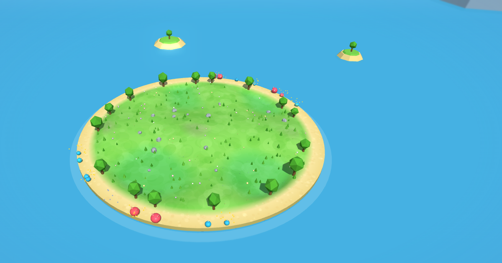

# Evolução 3D: simulador de seleção natural

**Jogar agora:** https://francisco12-cpu.github.io/simulador-evolucao/

Criaturas de duas espécies (azuis e rosas) saem da areia de uma ilha, procuram frutas e precisam voltar antes de a
energia acabar. Quem volta com duas frutas tem um filho, que herda velocidade, tamanho, visão e clima ideal com pequenas
mutações. Ninguém programa quem é "melhor": a aptidão surge do comportamento, e a seleção natural acontece na sua frente.

Um único arquivo HTML, sem instalação e sem build, que funciona offline.

A interface usa tema claro e a identidade visual do projeto.

## Como abrir

1. Baixe ou clone esta pasta inteira (o `index.html` precisa da pasta `vendor/` ao lado).
2. Dê dois cliques no `index.html`. Funciona direto do disco (`file://`) em Chrome, Edge e Firefox.

Para publicar: o GitHub Pages serve a raiz da branch `main` sem configuração extra.

Atalhos: **Espaço** pausa, **1–4** mudam a velocidade, **F** explora a ilha, **M** liga e desliga o som, **H** oculta a
interface, **R** lê um resumo em texto (para leitores de tela). Com `index.html?debug=1` aparece um medidor de desempenho.

## Explorar a ilha

O botão **Explorar a ilha** (ou a tecla F) troca a vista de cima por uma câmera livre:

- **Andar**: passeie no meio das criaturas; os pés seguem os morros e vales.
- **Voar**: vá aonde quiser, até as ilhotas, o farol e os veleiros.

No computador, clique na tela para olhar com o mouse e use WASD ou as setas (Shift corre, Espaço e C sobem e descem).
No celular, use o joystick à esquerda e arraste à direita para olhar. Esc ou "Sair" volta para a vista normal.

## Modelos 3D reutilizáveis

Os objetos ao redor da ilha (palmeira, pedra, ilhota, farol, veleiro, gaivota, nuvem e montanha) estão em `js/modelos/`.
Cada modelo é fundido numa geometria só e usa um material compartilhado, então dezenas de cópias custam um único
draw call. Para criar outro, veja o comentário no topo de `js/modelos/base.js`.

## Como usar em aula

- **Comece pelo padrão** e observe os gráficos de traços médios: a velocidade sobe e o tamanho desce. Pergunte por quê
  (correr mais leva à fruta antes; ser grande gasta energia).
- **Compare "Pouca comida" com "Muita comida"**: com pouca, a população fica menor, as criaturas ficam menores e enxergam
  mais longe.
- **"Sem mutação (clones)"**: sem variação nova, só sobrevive o tipo que já era melhor. Bom para separar seleção de mutação.
- **"Predação"**: veja as populações de presas e predadores subirem e descerem fora de fase, e as rosas ficarem maiores.
- **"Era do gelo" e "Aquecimento global"**: o clima ideal médio acompanha o clima do dia, se a mudança for lenta o
  bastante.
- **Repita experimentos**: escreva uma seed em Ajustes (ou use "Repetir") e a execução se repete igual, inclusive os
  eventos que você disparou. Dois grupos com a mesma seed veem a mesma ilha.
- **Leve os dados para a planilha**: "Dados e cenário" baixa `diario.csv` (por dia e por espécie: média, desvio-padrão,
  nascimentos e mortes por causa), `individuos.csv` (cada criatura com pai, nascimento, morte e causa) e `cenario.json`
  (para repetir a execução). Os CSV usam vírgula como separador e ponto como decimal; as linhas que começam com `#` são o
  cabeçalho (seed, versão, configuração). No pandas: `read_csv(arquivo, comment='#')`; no R: `read.csv(arquivo, comment.char='#')`.

## Como funciona o modelo

Cada regra tem uma classe:
**(1)** conhecimento científico estabelecido, **(2)** simplificação para viabilizar a simulação,
**(3)** hipótese que depende de parâmetros, **(4)** decisão de design sem correspondência biológica direta.

| Regra | Resumo | Classe |
|---|---|---|
| Seleção | Sobrevivência e reprodução diferenciais emergem do forrageio | (1) mecanismo, (2) implementação |
| Herança e mutação | Filho copia o pai com ruído gaussiano em cada traço; reprodução assexuada | (2) |
| Deriva | Emerge da amostragem em populações pequenas; espécies idênticas vencem ~50/50 (teste automatizado) | (1) |
| Reprodução | 2 frutas: 1 filho; 1 fruta: sobrevive; 0: morre | (4) |
| Custo de energia | ∝ tamanho³ · velocidade², mais visão e um termo basal; reserva quase constante | (2)/(3) |
| Disputa por fruta | Só entre quem toca a fruta ao mesmo tempo; o maior tem mais chance | (2) |
| Clima | Custo cresce com o quadrado da distância ao clima ideal; altitude esfria | (2) |
| Predação | Com predação ligada, as rosas viram carnívoras e caçam azuis pelo menos 30% menores; a presa foge quando enxerga o predador | (2) |
| Água e eventos | Beber ajuda a reproduzir; secas e chuvas mudam a quantidade de frutas | (4)/(2) |

## Limitações (o que o simulador **não** afirma)

- Um "dia" não é uma geração real, e a ilha não tem escala real de espaço ou tempo.
- Para quem come fruta, ser grande só custa energia: o tamanho diminui e as rosas costumam se extinguir quando competem
  com os azuis pelas mesmas frutas (exclusão competitiva). No preset de predação, as rosas viram predadoras e aí o tamanho
  volta a valer a pena; mesmo assim, em parte das execuções os predadores somem da ilha.
- A seca reduz só a **quantidade** de frutas. O caso real das tentilhas de Galápagos dependeu da **composição** das
  sementes, então o simulador não reproduz esse caso (o preset se chama "Secas seguidas numa ilha").
- A extinção em massa mata ao acaso; no evento real (K-Pg) ela foi seletiva.
- Os coeficientes são pontos de partida, não valores calibrados com dados reais.

## Desempenho

A qualidade gráfica se ajusta sozinha (Alta, Média ou Baixa; também dá para escolher em Ajustes). No celular começa em
Média. Medições feitas até agora: Edge headless num notebook com Intel UHD, 1440×900, 60 fps sem bloom e cerca de 47 fps
com bloom; o motor gasta menos de 1 ms por quadro. **Ainda não há medição num celular real.**

## Estrutura

| Caminho | Conteúdo |
|---|---|
| `index.html` | Página do simulador |
| `css/` | Estilos (tema claro e abertura) |
| `js/sim.js` | Motor da simulação (regras, sem 3D) |
| `js/modelos/` | Modelos 3D reutilizáveis (palmeira, farol, veleiro, gaivota...) |
| `js/` | Cena 3D, entorno, câmera livre, sons e interface |
| `vendor/three-r128/` | Three.js r128 (biblioteca de terceiros, licença MIT) |
| `404.html` | Página de erro personalizada |

## Créditos

Criado por **Francisco Audir** ([@filho.af](https://instagram.com/filho.af)).
Usa [Three.js](https://threejs.org) r128.

## Licença

Código sob [MIT](LICENSE). Textos, documentação e identidade visual sob [CC BY 4.0](LICENSE-CONTEUDO).
